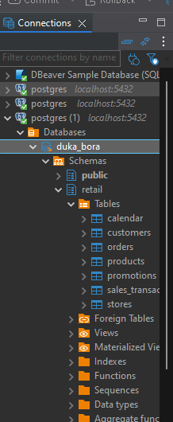
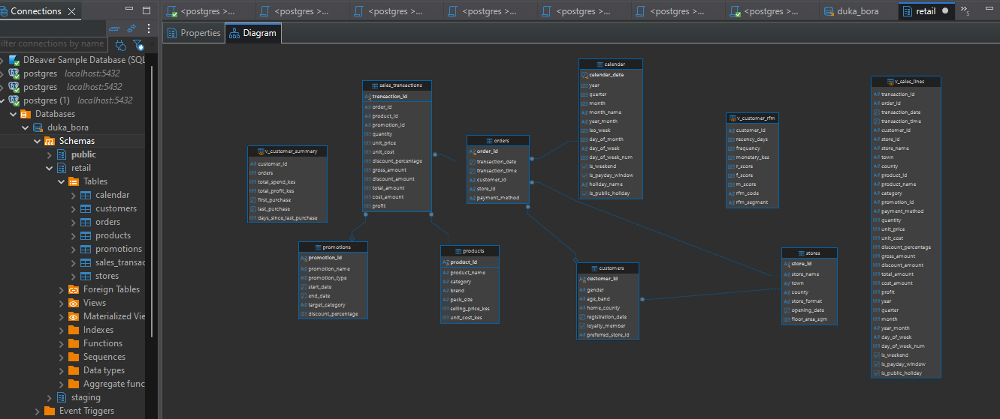
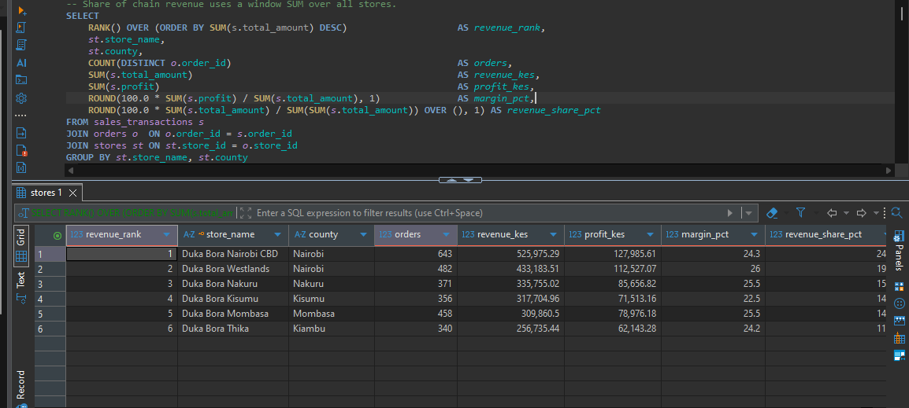
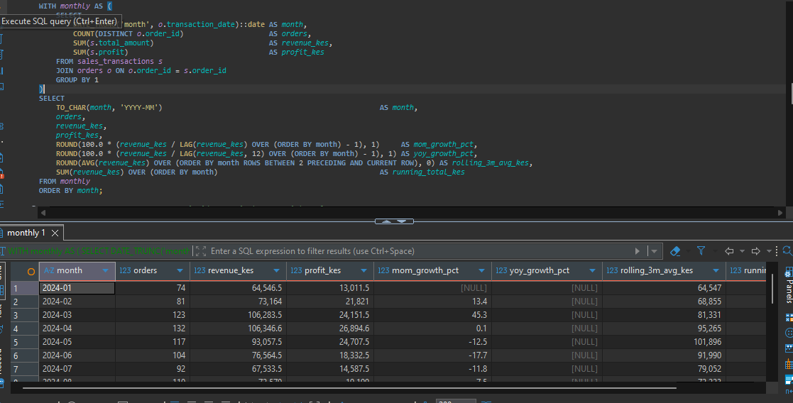
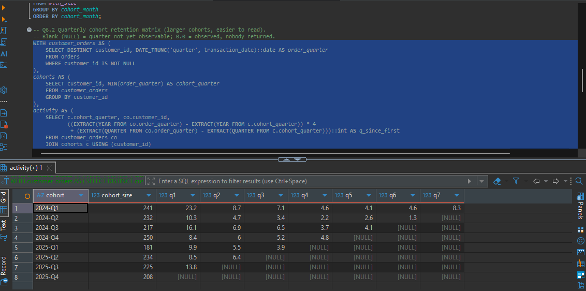
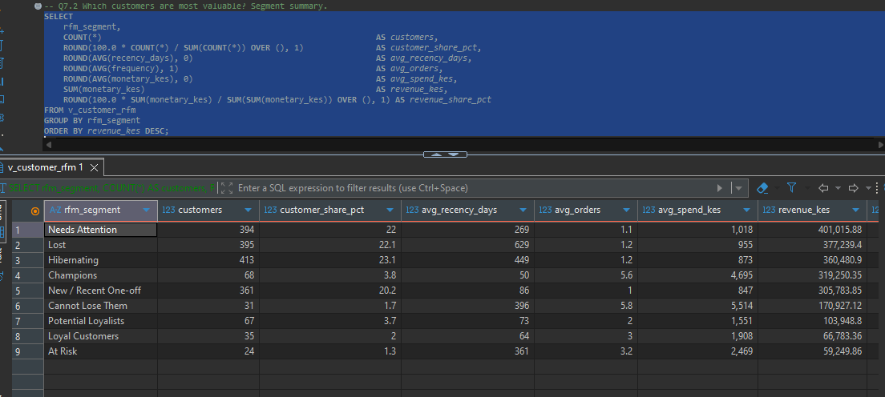

# Milestone 4: SQL Analytics (PostgreSQL)

The cleaned data is loaded into a **normalized PostgreSQL 18 database** (`duka_bora`, schema `retail`) with primary keys, foreign keys and CHECK constraints. Seven SQL scripts answer the business questions. Every script runs from scratch without errors, and its output is saved as evidence in [`outputs/`](outputs/).

## Database design

```
stores (PK store_id) ──< orders (PK order_id) >── customers (PK customer_id)
                            │   │                     │
calendar (PK calendar_date)─┘   │                     └── preferred_store_id → stores
                                │
products (PK product_id) ──< sales_transactions (PK transaction_id) >── promotions (PK promotion_id)
```

**Why it is normalized (third normal form):**
- **Order details are stored once.** Date, time, customer, store and payment method are the same for every line of a receipt, so they live once in `orders` (2,650 rows) rather than being repeated on all 2,988 lines of `sales_transactions`.
- **Money columns are generated by the database.** `gross_amount`, `discount_amount`, `total_amount`, `cost_amount` and `profit` are `GENERATED ALWAYS AS (...) STORED` columns calculated from quantity, price, cost and discount, so they cannot disagree with those fields.
- **Business rules are enforced as constraints.** Examples:
  - quantity > 0;
  - cost < price;
  - a discount appears only on promotion lines (and every promotion line has one);
  - a product appears only once per receipt;
  - payment methods and categories come from fixed lists.
- **Convenience views.** `v_sales_lines` (one fully joined row per line, for Power BI), `v_customer_summary` and `v_customer_rfm` store no data, so the tables stay normalized.

## How to run

**Option A: one command (PowerShell, from the project root).** This reads connection settings from the git-ignored `.env` file and saves each script's output to `milestone_4_sql/outputs/`:
```powershell
.\sql\run_sql.ps1
```

**Option B: DBeaver.**
1. Create a PostgreSQL connection to `localhost:5432`, database `duka_bora`, user `postgres`.
2. Load the data once with Option A, or run this from the project root:
   ```powershell
   psql -d duka_bora -f sql/02_load_data.sql
   ```
   `\copy` is a psql command, so DBeaver cannot run `02_load_data.sql` itself.
3. Open scripts `03` to `07` and run them with **Execute script (Alt+X)**. Each query's result opens in its own tab.

## Scripts and techniques

| Script | Purpose | Techniques demonstrated |
|---|---|---|
| [01_create_tables.sql](../sql/01_create_tables.sql) | Schema, keys, constraints, indexes, view | PK/FK, CHECK, UNIQUE, generated columns, indexes |
| [02_load_data.sql](../sql/02_load_data.sql) | CSV → staging → typed tables | `\copy`, explicit casts, `NULLIF`, transaction |
| [03_data_quality_checks.sql](../sql/03_data_quality_checks.sql) | Prove the load is correct | LEFT JOIN orphan checks, `FILTER`, `NOT EXISTS`, catalogue queries |
| [04_sales_analysis.sql](../sql/04_sales_analysis.sql) | Stores, products, categories, months, order value | JOINs, GROUP BY/HAVING, CASE, CTE, `RANK`/`DENSE_RANK`/`ROW_NUMBER`, `LAG`, rolling `AVG OVER`, running `SUM OVER`, `DATE_TRUNC`, `PERCENTILE_CONT` |
| [05_customer_analysis.sql](../sql/05_customer_analysis.sql) | Top customers, lapsed customers, value tiers | View, `NTILE`, CASE bands, cumulative window share |
| [06_cohort_analysis.sql](../sql/06_cohort_analysis.sql) | Retention by first-purchase cohort | Multi-step CTEs, `AGE`, `FIRST_VALUE`, `FILTER` pivot, `EXISTS` |
| [07_rfm_analysis.sql](../sql/07_rfm_analysis.sql) | RFM scores and segments | CASE scoring, `NTILE`, view, segment rules |

## Business questions answered

| Question | Query | Answer |
|---|---|---|
| Which stores generate the highest revenue? | Q4.1 | **Nairobi CBD** (KES 526K, 24.1%), then Westlands (KES 433K, 19.9%), Nakuru, Kisumu, Mombasa and Thika (KES 257K, 11.8%). Westlands has the best margin (26.0%), Kisumu the lowest (22.5%) |
| Which products generate the highest profit? | Q4.2 | The top 5 are all **clothing**: school uniform set (KES 60.9K), kitenge dress, denim jeans, T-shirt, canvas shoes (39–44% margin). The smartphone is 6th (16% margin) |
| Which categories perform best? | Q4.3 | **Clothing**: 46.3% of profit at a 42% margin. Food and Groceries has the most lines (1,106) but only 12% of profit (11.7% margin) |
| Who are the top 10 customers? | Q5.1 | Led by C0066 (KES 27.9K, 5 orders). The list mixes frequent buyers (9–10 orders) and one-off electronics buyers. Four of the top 10 have been silent for over 270 days |
| What are the monthly sales trends? | Q4.4, Q4.5 | December is the peak in both years (KES 119K, then 141K). Revenue is +8.8% and profit +10.7% year on year, while **units are −4.7%** and orders +3.8%. The rolling 3-month average smooths out swings caused by single electronics sales |
| What is the average order value? | Q4.6 | **KES 822 (median KES 450)**. Highest when paid by bank transfer (KES 1,440) or card (KES 1,057); lowest at Mombasa (KES 677) |
| Which customers have not purchased recently? | Q5.2, Q5.2b | Of 419 repeat customers, **249 have been silent for more than 180 days** (164 for over a year), with KES 541K of lifetime spend. 170 repeat customers are still active |
| What is customer retention by cohort? | Q6.1–Q6.3 | Retention is low. After the first quarter, typically 8–16% of a cohort returns (23% for the 2024-Q1 cohort, which includes pre-2024 customers). Within 6 months, 25.1% of 2024 cohorts returned vs 18.8% of 2025 cohorts |
| Which customers are most valuable? | Q5.3, Q7.2, Q7.4 | The top 10% of customers produce 43.3% of revenue. **68 Champions** (3.8% of customers) produce 14.7% of revenue, averaging 5.6 orders and KES 4,695 |

### Further findings
- **Weekday pattern (Q4.7):** Saturday averages 4.52 orders per calendar day and Friday 4.22, against 3.00 on Monday.
- **Best seller by store (Q4.8):** fresh milk is the top unit seller in four stores and maize flour in Kisumu. Nakuru's top item is bottled water, partly because of the genuine bulk purchase of 60 bottles.
- **Frequency (Q5.4):** one-off customers are 76.6% of customers but only 52.3% of revenue. Customers with 6 or more orders are 2% of customers and 10.7% of revenue.
- **Loyalty (Q5.5):** members' repeat rate is 41.7%, against 14.7% for non-members. This is an association, not proof of cause.
- **Home-store loyalty (Q5.6):** 87.8% of identified orders are placed at the customer's preferred store.
- **Win-back list (Q7.5):** the **"Cannot Lose Them" (31) and "At Risk" (24)** segments are the 55 formerly frequent customers silent for more than 6 months, with KES 230K of past spend. This matches the Milestone 3 Python analysis exactly.
- **At-risk share by store (Q7.6):** **Thika** has the highest share of at-risk customers (4.6%), consistent with its revenue decline in Milestone 3.

## RFM method

| Score | Recency (days since last purchase) | Frequency (orders) | Monetary (spend quintile) |
|---|---|---|---|
| 5 | ≤ 90 | 6+ | top 20% (KES 1,800+) |
| 4 | 91–180 | 4–5 | 60–80% |
| 3 | 181–365 | 3 | 40–60% |
| 2 | 366–545 | 2 | 20–40% |
| 1 | > 545 | 1 | bottom 20% |

**Why fixed bands for recency and frequency, but quintiles for spend?**
- **Frequency:** 77% of customers have exactly one order. Quintiles would give identical customers different scores at random.
- **Recency:** quintiles were tried first, but they produced bands so wide (255–406 days = score 3) that a customer silent for ten months was labelled "Loyal". Fixed bands read naturally to management (last quarter, last half-year, last year).
- **Spend:** spend varies smoothly, so quintiles give a fair relative ranking.

| Segment | Rule | Customers | Revenue share |
|---|---|---:|---:|
| Champions | R ≥ 4, F ≥ 4 | 68 | 14.7% |
| Loyal Customers | R ≥ 4, F = 3 | 35 | 3.1% |
| Potential Loyalists | R ≥ 4, F = 2 | 67 | 4.8% |
| New / Recent One-off | R ≥ 4, F = 1 | 361 | 14.1% |
| Cannot Lose Them | R ≤ 3, F ≥ 4, M = 5 | 31 | 7.9% |
| At Risk | R ≤ 3, F ≥ 3 | 24 | 2.7% |
| Needs Attention | R = 3, F ≤ 2 | 394 | 18.5% |
| Hibernating | R = 2, F ≤ 2 | 413 | 16.7% |
| Lost | R = 1, F ≤ 2 | 395 | 17.4% |

## Verification evidence
- **Data-quality checks ([outputs/03](outputs/03_data_quality_checks.txt)):**
  - row counts match the cleaned CSVs;
  - no orphan rows;
  - every order falls in the study period;
  - every promotion line follows its campaign's rules.
- **The database's generated revenue, discount and profit match the Python-cleaned values on all 2,988 lines** (KES 2,179,214.72 in both).
- The full rebuild (`.\sql\run_sql.ps1`) runs all seven scripts in about 4 seconds with no errors.

## DBeaver evidence

**Connection to `duka_bora`: the 7 tables in the `retail` schema**



**ER diagram: primary and foreign key relationships (plus the analysis views)**



**Q4.1: store revenue ranking (RANK and a window SUM)**



**Q4.4: monthly trend with LAG, rolling average and running total.** The first rows show `NULL` growth because there is no earlier month or year to compare against.



**Q6.2: quarterly cohort retention.** `NULL` = quarter not yet observable.



**Q7.2: RFM segment summary**


