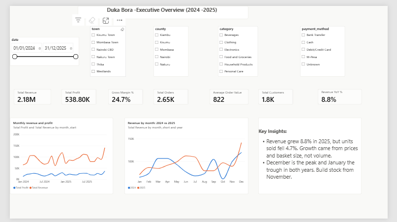
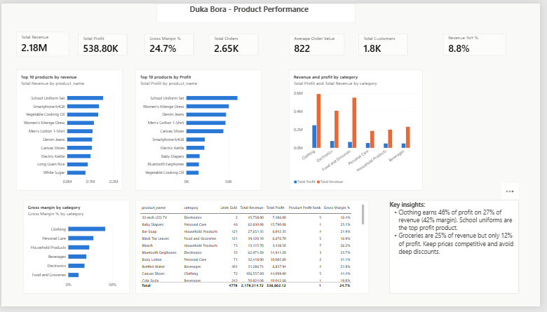
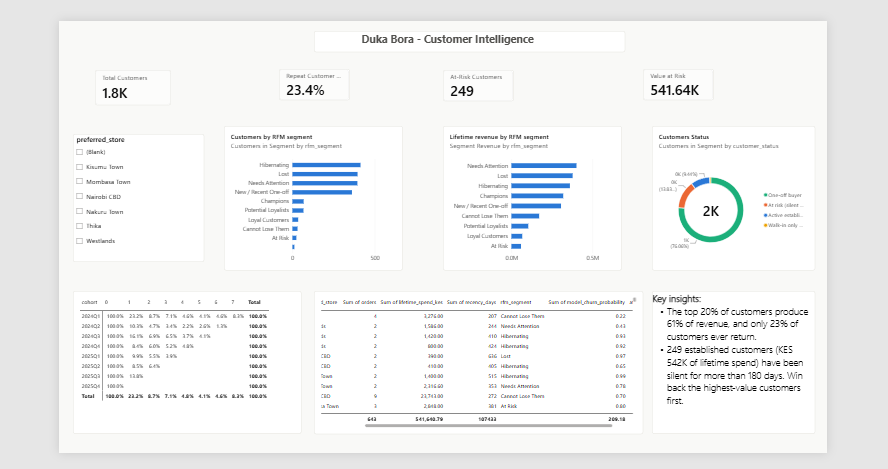
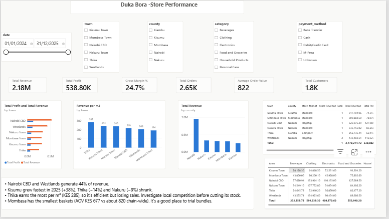
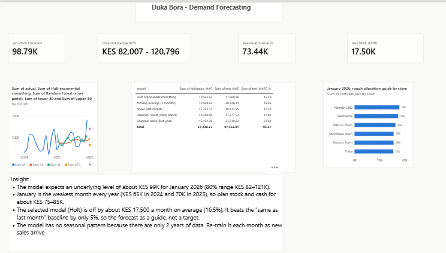

# Milestone 7: Power BI Dashboard

A five-page management dashboard for Duka Bora, built in Power BI Desktop on a star-schema model exported from the
cleaned data and the Milestone 6 model outputs.

## Deliverables

| Deliverable | Location |
|---|---|
| Power BI report | [Duka_Bora_Dashboard.pbix](Duka_Bora_Dashboard.pbix) |
| Screenshots of every page | [screenshots/](screenshots/) |
| Data model export (code) | [src/visualization/powerbi_export.py](../src/visualization/powerbi_export.py) |
| Data model export (files) | [data/powerbi/](../data/powerbi/) |
| DAX measures and KPI definitions | [dax_measures.md](dax_measures.md) |
| Report theme (project palette) | [duka_bora_theme.json](duka_bora_theme.json) |
| Step-by-step build guide | [BUILD_GUIDE.md](BUILD_GUIDE.md) |

To regenerate the data files after any change upstream, run this from the project root, then click **Refresh** in Power BI:

```powershell
python -m src.visualization.powerbi_export
```

---

## Data model

A star schema, with `fact_sales` (2,988 sales lines) at the centre:

| Table | Rows | Role | Relationship |
|---|---:|---|---|
| `fact_sales` | 2,988 | One row per sales line | Fact table |
| `dim_date` | 731 | Calendar, 2024-01-01 to 2025-12-31 (marked as date table) | `date` → `fact_sales[date]`, 1:\* |
| `dim_store` | 6 | Town, county, format, floor area | `store_id`, 1:\* |
| `dim_product` | 40 | Product, category, brand | `product_id`, 1:\* |
| `dim_customer` | 1,800 | Profile + RFM segment + at-risk flag + churn score at 31 Dec 2025 | `customer_id`, 1:\* |
| `fact_forecast` | 25 | Monthly actual vs forecasts, January 2026 forecast and ranges | Not related (summary table) |
| `forecast_store_jan2026` | 6 | January 2026 forecast split by store | Not related |
| `cohort_retention` | 36 | Quarterly cohort retention, long format | Not related |
| `model_metrics` | 10 | Accuracy of every Milestone 6 model | Not related |

All relationships are many-to-one with single-direction filtering. RFM segments are computed with exactly the same
rules as [sql/07_rfm_analysis.sql](../sql/07_rfm_analysis.sql), and the counts match the SQL output (68 Champions,
31 Cannot Lose Them, 24 At Risk).

## Pages

Every sales page shares five synced slicers: **date range, town, county, product category and payment method**.
Clicking any bar or point cross-filters the rest of the page.

### 1. Executive Overview



- **KPI cards:** total revenue, total profit, gross margin, orders, customers, average order value and revenue growth.
- **Monthly revenue and profit trend**, January 2024 to December 2025.
- **Year-on-year comparison** by month (2024 vs 2025).
- **Key insights:** revenue grew 8.8% while units fell 4.7%, and December peaks while January troughs.

### 2. Product Performance



- **Top 10 products by revenue and by profit.** The two lists differ: clothing dominates profit.
- **Revenue and profit by category, plus gross margin by category.**
- **Product table** with units, revenue, profit, profit rank and margin.

### 3. Customer Intelligence



- **Cards:** total customers, repeat customer rate (23.4%), at-risk customers (249) and value at risk (KES 541.64K).
- **RFM segments** by customer count and by lifetime revenue.
- **Customer status donut:** one-off, active established, at risk, and walk-in only.
- **Quarterly cohort retention matrix.**
- **Win-back list:** the 249 at-risk customers with spend, recency, RFM segment and churn probability. Its total
  (KES 541,641) matches the Value at Risk card.
- **Filtering:** a `preferred_store` slicer filters this page. The customer visuals describe each customer at
  31 Dec 2025, so the date slicer intentionally does not change them.

### 4. Store Performance



- **Revenue and profit by store, revenue per m² and revenue by county.**
- **Store ranking table** with margin, average order value and 2025 growth.
- **Category mix by store** (matrix).

### 5. Demand Forecasting



- **Cards:** January 2026 forecast (KES 98.79K), 80% range (KES 82,007 – 120,796), seasonal scenario (KES 73.44K)
  and the Holt test error (MAE KES 17.50K).
- **Actual vs one-month-ahead forecasts.**
- **Model accuracy table.**
- **January 2026 store allocation guide.**

---

## KPI definitions

Full DAX for every measure is in [dax_measures.md](dax_measures.md).

| KPI | Definition | Value (all data) |
|---|---|---:|
| Total Revenue | Sum of net revenue after promotional discounts | KES 2,179,215 |
| Total Profit | Net revenue − cost of goods sold | KES 538,802 |
| Gross Margin % | Profit ÷ revenue | 24.7% |
| Total Orders | Distinct receipts (not product lines) | 2,650 |
| Average Order Value | Revenue ÷ orders | KES 822 |
| Total Customers | Distinct identified customers who bought (walk-ins excluded) | 1,788 |
| Revenue YoY % | 2025 revenue vs 2024 revenue | +8.8% |
| Revenue per m² | Revenue ÷ store floor area | KES 285 (Thika) to 194 (Mombasa) |
| Repeat Customer Rate | Customers with 2+ orders ÷ customers with 1+ order | 23.4% |
| At-Risk Customers | Customers with 2+ orders and no purchase for more than 180 days at 31 Dec 2025 | 249 |
| Value at Risk | Lifetime spend of at-risk customers | KES 541,641 |
| Jan 2026 Forecast | Damped Holt exponential smoothing, the model selected in Milestone 6 | KES 98,788 |

## Verification

With all slicers cleared, every headline figure was checked against the Python and SQL results from Milestones 3–6:

| Figure | Dashboard | Analysis | Source |
|---|---:|---:|---|
| Total revenue | 2.18M | 2,179,215 | M3 notebook 04, M4 SQL |
| Total profit | 538.80K | 538,802 | M3, M4 |
| Orders | 2.65K | 2,650 | M3, M4 |
| Average order value | 822 | 822 | M3 |
| Revenue growth 2025 | 8.8% | 8.8% | M3 |
| Repeat customer rate | 23.4% | 23.4% | M4 SQL |
| At-risk customers / value | 249 / 541.64K | 249 / 541,641 | M6 notebook 07 |
| January 2026 forecast | 98.79K | 98,788 | M6 notebook 07 |

## Recommendations for management

1. **Protect clothing margins.** Clothing earns 46% of profit on 27% of revenue (42% margin). School uniforms are
   the most profitable product. Keep them in stock before each school term and avoid discounting them.
2. **Stop deep discounts on groceries and electronics.** Groceries are 25% of revenue but 12% of profit. Milestone 3
   found promotion margins of only 1–3% in these categories.
3. **Run a win-back campaign** for the 249 at-risk customers (KES 542K of lifetime spend), highest-value first. Hold
   back a random 20% as a control group to measure the real effect.
4. **Investigate Thika and Nakuru.** Both shrank in 2025 (−14% and −9%), although Thika earns the most per m².
   Check for local competition before cutting stock.
5. **Trial bundles in Mombasa,** which has the smallest baskets (AOV KES 677 vs 822 chain-wide).
6. **Plan January 2026 for KES 75–85K,** not the model's 99K. January is the weakest month every year, and the
   model cannot yet learn seasonality from two years of data. Build stock from November for the December peak.

## Limitations

- **The data is synthetic.** The patterns were designed to be realistic, but the figures are not real Kenyan retail
  results.
- **Customer visuals are a snapshot at 31 Dec 2025** and do not respond to the date slicer.
- **The store allocation for January 2026** takes the Random Forest's store forecasts and rescales them to add up
  to the chain forecast. Treat it as a rough guide: store-level forecasts were far less accurate (MAPE about 50%).
- **Forecast ranges** come from the model's own walk-forward errors over 12 months, so they are approximate.
